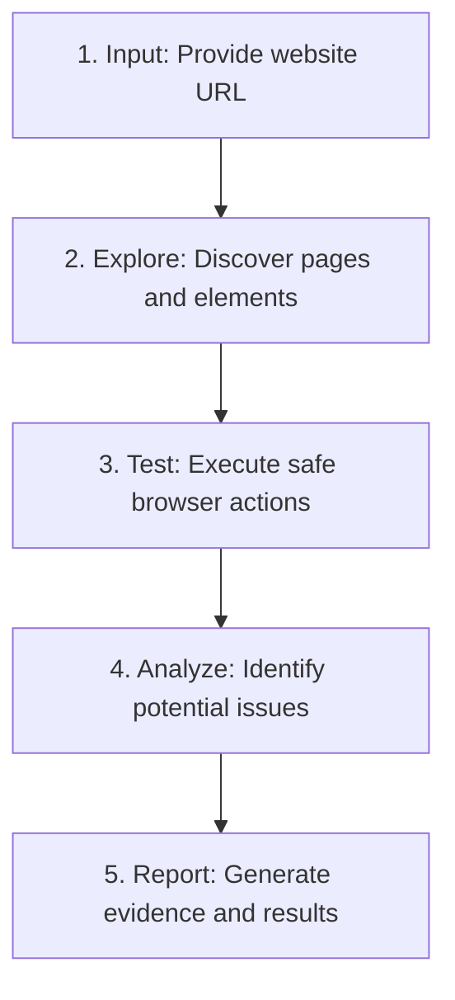

<div align="center">

# AI Pirates

**VTU-QFF-HC-0142** &nbsp;|&nbsp; Tier: **Online**

</div>

---

<div align="center">

| | |
| :--- | :--- |
| **Team** | AI Pirates |
| **Team ID** | VTU-QFF-HC-0142 |
| **Tier** | Online |
| **Repository** | [vtu-hc-ai-pirates](https://github.com/vtu-qiskit-fall-fest-2026/vtu-hc-ai-pirates.git) |
| **Organisation** | [vtu-qiskit-fall-fest-2026](https://github.com/vtu-qiskit-fall-fest-2026) |
| **Event** | VTU-QFF Hackathon — VTU-Qiskit Fall Fest 2026 |

</div>

---

## 📌 Table of Contents

- [Team Members](#-team-members-github-ids)
- [Problem Statement](#-problem-statement)
- [Proposed Solution](#-proposed-solution)
- [Approach & Architecture](#-approach--architecture)
- [Tech Stack](#-tech-stack)
- [Project Structure](#-project-structure)
- [How to Run](#-how-to-run)
- [How to Push Code](#-how-to-push-code)
- [Submission Checklist](#-submission-checklist)
- [Resources](#-resources)
- [License](#-license)

---

## 👥 Team Members (GitHub IDs)

> Members are added to this repository as **collaborators** and must accept the
> GitHub invitation before they can push. Add your GitHub username below.

| # | Name | GitHub Username | Role |
| :-- | :--- | :--- | :--- |
| 1 | Yash Vikas Gayake | [@yashgayake](https://github.com/yashgayake) | Team Lead & Quantum Security Research |
| 2 | Pranav Janardhan Kadam | [@pranavkadm](https://github.com/Pranavkadam96) | Quantum Algorithm & Qiskit Development |
| 3 | Kamini Janardhan Borde | [@kaminiborde](https://github.com/kaminiborde) | Testing, Results Analysis & Documentation |

<!--
Optional: add a plain list instead of the table above.
- @username1
- @username2
-->

---

## ❓ Problem Statement

**Problem:** The advancement of quantum computing presents potential challenges to conventional cryptographic systems, particularly those that rely on computational problems that may become easier for powerful quantum computers to solve. There is a need to explore quantum cryptography techniques and evaluate how they can contribute to secure communication and improved security.

**Why it matters:** Understanding the impact of quantum computing on cryptography is important for protecting sensitive information and preparing for future security challenges. Exploring quantum-based security approaches can help identify potential opportunities and limitations in quantum-secure communication.

**Track / Category:** Online · Quantum Cryptography and Security

---

## 💡 Proposed Solution

<!--
Describe your solution. Keep it concrete: the core idea, the user flow, and
the quantum/ML technique you are applying.
-->

**Solution:** AI Pirates aims to develop a Python-based quantum security prototype using Qiskit. The system will implement a quantum algorithm or circuit suited to the confirmed problem statement, simulate its operation, and analyze the results to evaluate its effectiveness for the selected security challenge.

**Key idea:** Use Qiskit to build and simulate a quantum circuit, process its measurement outcomes, and evaluate relevant security or performance metrics.

**Why this works:** Quantum circuit simulation provides a reproducible way to test the selected approach, analyze its behavior, and assess its potential for addressing the target security problem.

---

## 🧩 Approach & Architecture

<!--
Walk through how it works. A simple pipeline diagram in text or Mermaid is ideal.
-->
The proposed workflow explores quantum cryptography techniques using Qiskit to study their potential for secure communication.



## 🛠️ Tech Stack

| Layer | Technology |
| :--- | :--- |
| **Programming Language** | Python 3.11+ |
| **Quantum SDK** | Qiskit |
| **Quantum Simulation** | Qiskit Aer (`AerSimulator`) |
| **Optimization** | Qiskit Optimization / COBYLA / SPSA (if required) |
| **Development Environment** | JupyterLab / VS Code, Python `venv` |
| **Version Control** | Git + GitHub |
---

## 📁 Project Structure

```text
vtu-hc-ai-pirates/
├── README.md              # Project documentation
├── requirements.txt       # Python dependencies
├── pyproject.toml         # Project metadata (optional)
├── .gitignore             # Files excluded from Git
├── notebooks/             # Jupyter notebooks for experiments
│   └── exploration.ipynb
├── src/                   # Main source code
│   ├── __init__.py
│   ├── circuit.py         # Quantum circuit implementation
│   ├── optimizer.py       # Optional optimization logic
│   └── main.py            # Main entry point
├── data/                  # Input data, if required
├── tests/                 # Unit tests
│   └── test_circuit.py
└── docs/                  # Architecture, results, and reports
```

---

## 🚀 How to Run

### Prerequisites

- Python 3.11 or newer
- [Git](https://git-scm.com/downloads)
- A GitHub account with collaborator access to the repository

### 1. Clone the Repository

```bash
git clone https://github.com/vtu-qiskit-fall-fest-2026/vtu-hc-ai-pirates.git
cd vtu-hc-ai-pirates
```

### 2. Create a Virtual Environment

```bash
python -m venv .venv
```

**Windows (PowerShell):**

```powershell
.venv\Scripts\Activate.ps1
```

**Linux / macOS:**

```bash
source .venv/bin/activate
```

### 3. Install Dependencies

```bash
python -m pip install --upgrade pip
pip install -r requirements.txt
```

### 4. Run the Project

After the source code and dependencies are implemented:

```bash
python -m src.main
```

To launch JupyterLab, if installed:

```bash
jupyter lab
```

### 5. Run Tests

```bash
pytest -q
```

---

## 🔁 How to Push Code

### Configure Git (First Time Only)

Use your actual name and the email associated with your GitHub account.

```bash
git config --global user.name "Your Name"
git config --global user.email "you@example.com"
```

### Everyday Workflow

```bash
# 1. Get the latest changes
git checkout main
git pull origin main

# 2. Create a separate branch for your task
git checkout -b feature/quantum-security

# 3. Review and commit your changes
git status
git add .
git commit -m "feat: implement quantum security circuit"

# 4. Push your branch
git push -u origin feature/quantum-security

# 6. After approval, merge into main
git checkout main
git pull origin main
git branch -d feature/my-task
```

### Commit message convention

| Prefix | Meaning |
| :--- | :--- |
| `feat:` | New feature |
| `fix:` | Bug fix |
| `docs:` | Documentation only |
| `test:` | Adding or fixing tests |
| `refactor:` | Code restructure, no behaviour change |
| `chore:` | Build/config/dependency changes |

### Useful commands

```bash
git status              # what changed
git log --oneline -10   # recent commits
git diff                # review changes before committing
git stash               # shelve changes temporarily
git pull --rebase       # update your branch on top of main
```

### Collaborating on the same repo

- **Never push directly to `main`** — open a Pull Request.
- **Pull before you push** to avoid rejected commits.
- **Commit often** with clear messages.
- **Resolve conflicts** locally: `git pull --rebase`, fix the files, then `git add` + `git rebase --continue`.
- **Ask for a review** before merging — a second pair of eyes catches bugs fast.

---

## ✅ Submission Checklist

- [ ] Repository created and **public**
- [ ] All team members added as **collaborators** and invitations accepted
- ✅ `README.md` updated with project details, problem statement and proposed solution
- ✅ Team members listed under [Team Members](#-team-members-github-ids)
- [ ] `requirements.txt` committed and project runs from a clean clone
- [ ] Code pushed to `main` and the latest `main` builds successfully
- [ ] Notebooks committed with **cleared outputs** (or use `nbstrip`), if applicable
- [ ] `README.md` includes a demo screenshot or video link
- [ ] Short project summary submitted on the hackathon portal
---

## 📚 Resources

| Resource | Link |
| :--- | :--- |
| 🔁 Git & collaboration handbook | [Git & Collaboration Handbook](../vtu-hc-guide-git-and-collaboration) |
| ❓ Problem statements, solutions & terms | [Problem Statements, Solutions & Terms](../vtu-hc-guide-problem-and-solution) |
| 📄 README writing guide | [README Guide & Template](../vtu-hc-guide-readme-template) |
| ⚛️ Qiskit documentation | https://docs.quantum.ibm.com/ |
| ⚛️ Qiskit Runtime & primitives | https://quantum.cloud.ibm.com/docs/ |
| 🧪 Qiskit Aer simulator | https://docs.quantum.ibm.com/guides/simulator |
| 💻 IBM Quantum Platform | https://quantum.cloud.ibm.com/ |
| 🎓 Qiskit textbook | https://qiskit.qotlabs.org/learning/ |
| 📋 GitHub Docs | https://docs.github.com/ |

---

## 📄 License

Released under the [MIT License](LICENSE). See `LICENSE` for details.

---

<div align="center">

**AI Pirates** · Team ID `VTU-QFF-HC-0142` · Tier `Online`
· Built with ⚛️ Qiskit for the VTU-QFF Hackathon

[⬆ Back to Top](#ai-pirates)

</div>
