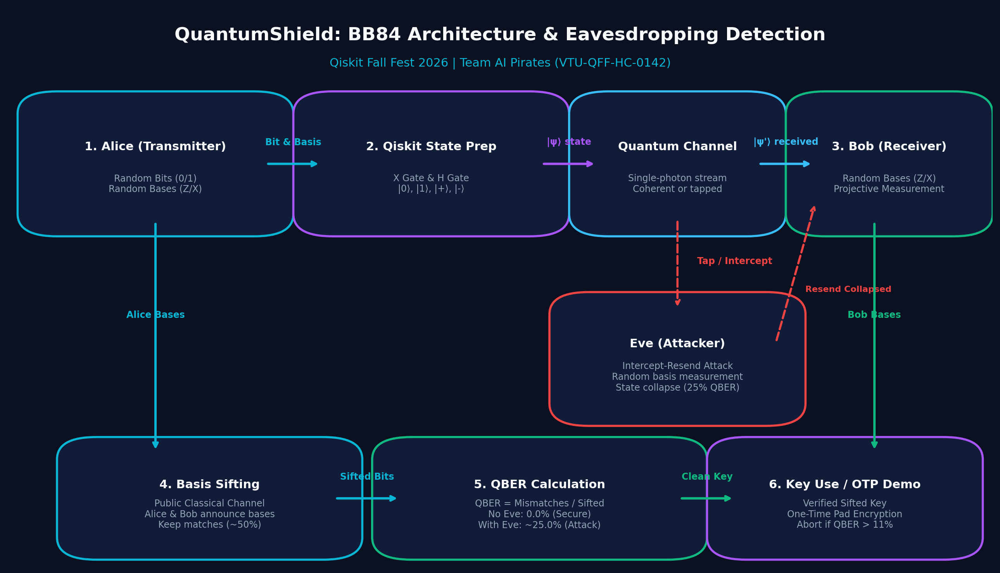

# QuantumShield: Technical Architecture

**Project:** QuantumShield — BB84 Quantum Key Distribution and Eavesdropping Detection  
**Hackathon:** Qiskit Fall Fest 2026  
**Track:** Quantum Cryptography & Security  
**Team:** AI Pirates  
**Team ID:** VTU-QFF-HC-0142  
**Repository:** `https://github.com/vtu-qiskit-fall-fest-2026/vtu-hc-ai-pirates`  

---

## 1. System Overview

QuantumShield is an interactive educational simulation and cryptographic benchmarking platform for the **Bennett-Brassard 1984 (BB84)** Quantum Key Distribution protocol. The platform utilizes **genuine Qiskit 2.x quantum circuits** to execute state preparation, channel transmission, intercept-resend eavesdropping, and basis measurement.



---

## 2. Mathematical Formalism & Quantum Mechanics

### 2.1 Mutually Unbiased Bases

The BB84 protocol leverages two conjugate, mutually unbiased measurement bases in a two-dimensional Hilbert space $\mathcal{H}_2$:

1. **Computational Basis (Z):**
   $$\mathcal{B}_Z = \{|0\rangle, |1\rangle\}$$
   Where $|0\rangle = \begin{pmatrix} 1 \\ 0 \end{pmatrix}, \quad |1\rangle = \begin{pmatrix} 0 \\ 1 \end{pmatrix}$.

2. **Diagonal / Hadamard Basis (X):**
   $$\mathcal{B}_X = \{|+\rangle, |-\rangle\}$$
   Where:
   $$|+\rangle = \frac{|0\rangle + |1\rangle}{\sqrt{2}} = \frac{1}{\sqrt{2}}\begin{pmatrix} 1 \\ 1 \end{pmatrix}$$
   $$|-\rangle = \frac{|0\rangle - |1\rangle}{\sqrt{2}} = \frac{1}{\sqrt{2}}\begin{pmatrix} 1 \\ -1 \end{pmatrix}$$

The transition probabilities between any state in $\mathcal{B}_Z$ and any state in $\mathcal{B}_X$ are strictly uniform:
$$|\langle 0 | + \rangle|^2 = |\langle 0 | - \rangle|^2 = |\langle 1 | + \rangle|^2 = |\langle 1 | - \rangle|^2 = \frac{1}{2}$$

---

## 3. Protocol Stages & Circuit Pipeline

```
+---------------------------------------------------------------------------------+
|                                 BB84 PIPELINE                                   |
|                                                                                 |
|  [ Alice ] ---> (Qiskit Prep) ---> [ Quantum Channel ] ---> (Bob Measure) --->  |
|     |                                     |                         |           |
|     |                               [Eve Intercept]                 |           |
|     v                                     |                         v           |
|  Alice Basis                        (Resend State)              Bob Basis       |
|     \                                                               /           |
|      =======> [ Classical Sifting (Public Reconciliation) ] <=======            |
|                                     |                                           |
|                                     v                                           |
|                         [ Sifted Keys: Alice & Bob ]                            |
|                                     |                                           |
|                                     v                                           |
|                        [ QBER Error Rate Analysis ]                             |
|                                     |                                           |
|              +----------------------+----------------------+                    |
|              | (QBER <= 5%)                                | (QBER > 11%)       |
|              v                                             v                    |
|      [ Key Established ]                           [ ABORT / EVE DETECTED ]     |
+---------------------------------------------------------------------------------+
```

### Stage 1: Alice's State Preparation
Alice randomly samples bit $a_i \in \{0, 1\}$ and basis $b_i^A \in \{Z, X\}$.
The Qiskit quantum circuit applies:
- For $(0, Z)$: Identity (state remains $|0\rangle$)
- For $(1, Z)$: Pauli-X gate ($X|0\rangle = |1\rangle$)
- For $(0, X)$: Hadamard gate ($H|0\rangle = |+\rangle$)
- For $(1, X)$: Pauli-X gate followed by Hadamard ($H X |0\rangle = |-\rangle$)

### Stage 2: Quantum Channel & Eve's Intercept-Resend Attack
When Eve is enabled:
1. Eve selects a random basis $b_i^E \in \{Z, X\}$.
2. If $b_i^E = X$, she applies an $H$ gate before measuring in the computational basis.
3. The measurement collapses the wavefunction to an eigenvalue $e_i \in \{0, 1\}$.
4. Eve re-prepares a replacement qubit corresponding to $(e_i, b_i^E)$ and sends it to Bob.

### Stage 3: Bob's Measurement
1. Bob independently selects a random basis $b_i^B \in \{Z, X\}$.
2. If $b_i^B = X$, Bob applies an $H$ rotation gate.
3. Bob performs a projective measurement $\mathcal{M}_Z$ to obtain bit outcome $b_i$.

### Stage 4: Classical Sifting
Alice and Bob communicate over an open classical channel and publish their basis choices $\{b_i^A\}$ and $\{b_i^B\}$.
The sifted index set is:
$$\mathcal{S} = \{i \in \{1, \dots, N\} \mid b_i^A = b_i^B\}$$
The expected sifting efficiency is $\mathbb{E}[|\mathcal{S}| / N] = 50\%$.

### Stage 5: Quantum Bit Error Rate (QBER) Calculation
Among the sifted indices $\mathcal{S}$, the Quantum Bit Error Rate is:
$$\mathrm{QBER} = \frac{\sum_{i \in \mathcal{S}} (a_i \oplus b_i)}{|\mathcal{S}|}$$

Theoretical expectations:
- **Without Eve (noiseless):** $\mathrm{QBER} = 0.0\%$
- **With Intercept-Resend Eve:**
  $$\mathrm{QBER}_{\text{Eve}} = P(b^E = b^A) \cdot 0 + P(b^E \neq b^A) \cdot \frac{1}{2} = 0.5 \times 0 + 0.5 \times 0.5 = 25.0\%$$

---

## 4. Software Engineering & Modularity

- `src/protocol.py`: Pure protocol dataclasses and deterministic sifting logic.
- `src/circuits.py`: Qiskit `QuantumCircuit` constructors and ASCII visualizers.
- `src/simulation.py`: Qiskit `Statevector` quantum evolution and probability sampling.
- `src/metrics.py`: QBER, Wilson score confidence intervals, and threshold checks.
- `src/visualization.py`: Publication-grade dark-themed Matplotlib figures.
- `src/utils.py`: Pandas conversions and One-Time Pad XOR validation.
- `app.py`: Streamlit responsive web dashboard.
- `tests/`: 20 unit and statistical tests passing with pytest.
